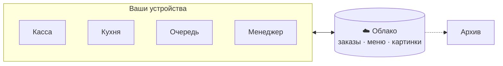

# 🌯 Kebab POS

**Облачная кассовая система для кафе: касса, кухня, очередь и менеджер в одном приложении**

### [⬇️ Скачать последнюю версию](../../releases/latest)

---

## 📥 Скачать

Все файлы лежат в разделе **[Releases](../../releases/latest)**. Выберите свой:

| Устройство | Файл | Как обновляется |
| --- | --- | --- |
| 🪟 Windows | `Kebab_Pos-Setup-X.Y.Z.exe` | **Автоматически**: приложение само скачает новую версию |
| 🍎 macOS | `Kebab_Pos-X.Y.Z.dmg` | Появится уведомление, скачать вручную |
| 🤖 Android | `Kebab_Pos-X.Y.Z.apk` | Появится уведомление, скачать и подтвердить установку |

> Здесь хранятся только готовые программы. Исходный код закрыт.

---

## ✨ Что умеет

| Раздел | Для кого | Что делает |
| --- | --- | --- |
| 💰 **Касса** | Кассир | Собирает заказ: блюдо, вариант, соусы, напитки, топпинги. Отправляет на кухню, ведёт снятия денег из кассы |
| 👨‍🍳 **Кухня** | Повар | Заказы от старых к новым, цвета срочности, звуковые сигналы, кнопка «Готово» |
| 📺 **Очередь** | Гости | Экран с номерами: что готовится и что уже можно забирать |
| 📊 **Менеджер** | Владелец | Редактор меню с картинками, статистика, архив, стили раскладки |
| 🛠 **Разработчик** | Администратор | Диагностика и служебные инструменты |

Дополнительно: **6 языков** (русский, English, O‘zbek, Türkçe, 日本語, नेपाली), светлая и тёмная тема, кнопка **«Отменить»** (откат последних 3 действий на устройстве).

---

## 🧭 Как это работает

### Путь заказа

1. **Кассир** собирает заказ, выбирает тип (в зале / с собой / по дороге) и отправляет на кухню. Заказ получает номер с буквой: `Z4`, `S5`, `P6`.
2. **Повар** видит заказ на экране кухни. Цвет карточки меняется: зелёный → жёлтый → красный, чем дольше ждёт заказ. Готово: нажимает большую зелёную кнопку.
3. **Гости** видят номер на экране очереди в колонке «Готово». Кассир тапает по номеру, когда заказ выдан.

Все экраны на разных устройствах обновляются сами, перезагружать страницу не нужно.

### Устройства работают вместе

Заказы, меню и касса хранятся **в облаке**, поэтому кассир, повар и экран очереди видят одно и то же в реальном времени, даже если это разные планшеты и компьютеры.

---

## 🚀 Установка

<b>🪟 Windows</b>

1. Скачайте `Kebab_Pos-Setup-X.Y.Z.exe` и запустите.
2. Если появится синее окно **«Windows защитила ваш компьютер»**, нажмите **Подробнее → Выполнить в любом случае**. Это нормально для программ без платной подписи.
3. Установка пройдёт сама, ярлык появится на рабочем столе.

<b>🍎 macOS</b>

1. Скачайте `.dmg`, откройте и перетащите приложение в «Программы».
2. При первом запуске нажмите на приложение **правой кнопкой → Открыть → Открыть** (программа без подписи Apple).
3. Если macOS пишет, что файл «повреждён», выполните в Терминале: `xattr -cr "/Applications/Kebab POS.app"`

<b>🤖 Android</b>

1. Скачайте `.apk` с телефона или планшета.
2. Откройте файл. Android попросит разрешить установку из этого источника (браузера): разрешите.
3. Нажмите «Установить».

---

## 🔄 Обновления

- **Windows:** приложение раз в 30 минут проверяет новую версию, само скачивает её и спрашивает: «Перезапустить сейчас» или «Позже». Если выбрать «Позже», обновление установится при закрытии.
- **Android и macOS:** в углу экрана появится окно **«Доступна новая версия»**. Нажмите «Обновить», скачайте файл и установите поверх старого. Данные сохранятся.

---

## 👍 Плюсы

- ✅ **Всё в одном.** Касса, кухня, очередь и менеджер в одном приложении, не нужно покупать несколько систем.
- ✅ **Синхронизация в реальном времени.** Заказ с кассы мгновенно появляется на кухне и в очереди.
- ✅ **Работает на чём угодно:** Windows, Mac, Android-планшеты и телефоны.
- ✅ **Быстрый старт.** Установили, вошли, работаете. Свой сервер не нужен.
- ✅ **Обновления выходят сами.** Исправления и новые функции приходят без переустановки (на Windows полностью автоматически).
- ✅ **Удобно на кухне.** Цвета срочности и звуковые сигналы: повар не пропустит заказ.
- ✅ **Гибкое меню.** Менеджер сам редактирует блюда, картинки, варианты и порядок, расположение панелей настраивается под экран.
- ✅ **Шесть языков** и тёмная тема: подходит для разных смен и сотрудников.
- ✅ **Номера заказов с буквами** (Z, S, P): сразу понятно, где гость, а где заказ «с собой».
- ✅ **Статистика и архив.** Старые данные уходят в архив, база остаётся быстрой.

## 👎 Минусы

- ⚠️ **Нужен интернет.** Приложение облачное. Без связи появляется окно «Нет подключения», работать нельзя, пока связь не вернётся (то, что уже сохранено на устройстве, отправится в облако после восстановления).
- ⚠️ **Зависит от облачных сервисов.** Если у сервиса, где хранятся данные, будет сбой, он затронет и приложение.
- ⚠️ **Нет подписи разработчика.** Windows и macOS показывают предупреждение при первом запуске. На Mac автообновление пока не работает, нужно обновляться вручную.
- ⚠️ **На Android обновление не тихое.** Каждый раз нужно скачать файл и подтвердить установку (так устроен Android вне Google Play).
- ⚠️ **Нет версии для iPhone/iPad.**
- ⚠️ **Настройки вида хранятся на устройстве.** Размеры панелей, раскладка, тема и язык не переходят между устройствами сами (можно сохранить стиль в облако и загрузить на другом).
- ⚠️ **«Отменить» работает только на том устройстве, где сделано действие,** и откатывает не больше 3 последних действий.
- ⚠️ **Закрытый код.** Изменения вносит только разработчик.

---

## ❓ Частые вопросы

**Пропадут ли данные при обновлении?**
Нет. Заказы и меню хранятся в облаке, а настройки вида на устройстве сохраняются при обновлении поверх.

**Можно ли на нескольких устройствах сразу?**
Да, так и задумано: касса, кухня и очередь работают на разных устройствах и видят одни и те же заказы.

**Что делать, если пропал интернет?**
Экран покажет окно «Нет подключения». Оно исчезнет само, как только связь вернётся (можно нажать «Проверить снова»).

**Как узнать, какая у меня версия?**
Сравните с номером последнего релиза в разделе [Releases](../../releases/latest). Если версия новее вашей, приложение само предложит обновиться.

---

**BSI Language Center** · Kebab POS

